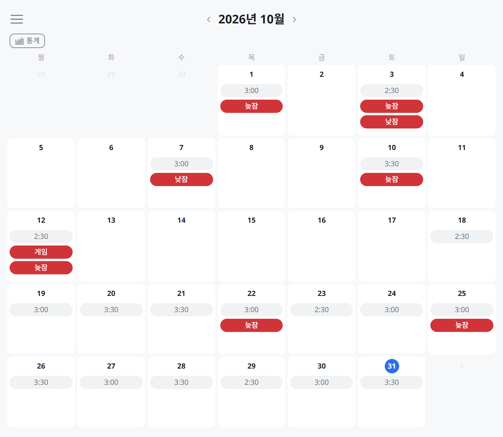

# Plan for myself

- 웹: https://plan-for-myself.vercel.app
- Android 앱: [스토어 링크]



> 매일 실패한 것을 기록하고, 그 실패를 성공으로 바꿔 나가고 싶었습니다.

## 제공되는 기능

1. **달력** — 매일 공부시간과 실패한 것을 기록합니다
2. **통계** — 어떤 실패를 반복하고, 어떤 실패를 줄였는지 지난달과 비교해 보여 줍니다

이를 통해, 같은 실패를 반복하지 않도록 유도하고자 합니다.

웹과 Android 앱에서 같은 기능을 씁니다.

## 구성

```
apps/web     (Next.js)      ─┐
                             ├──→  packages/shared  (타입 · 입력 한도와 문구 · 날짜 계산 · API 함수 · 훅)
apps/mobile  (React Native) ─┘
```

웹과 앱은 화면만 다를 뿐 로직은 대부분 같아서, 같은 로직을 한 번만 구현하고 한 번만 고치려고 [모노레포로 옮기고](https://github.com/developer-choi/plan-for-myself/pull/35) [공통 패키지를 같이 쓰게 했습니다](https://github.com/developer-choi/plan-for-myself/pull/36).

웹과 앱이 같이 쓰는 것의 예:

- `useRecordForm` — 기록을 저장·삭제하고 서버의 거절을 안내하는 폼 로직
- `createStudyRecordApi` — 기록 API 함수. 인증 방식이 다른 API 클라이언트를 인자로 받습니다
- `beforeSend` — 에러 보고(Sentry)로 보내기 전에 로그인 만료(401)를 버리고, 에러마다 심각도를 붙이는 규칙

## 앱 (React Native)

- 웹을 웹뷰로 띄우지 않고, 화면을 React Native로 다시 만들었습니다. 웹이 이미 있어 비용만 보면 웹뷰가 합리적이었지만, React Native를 익히는 것이 목적이었습니다. → [웹뷰 없이 앱을 배포하고 운영하기](docs/cases/development.md#웹뷰-없이-앱을-배포하고-운영하기)
- [Expo로 만들었습니다](https://github.com/developer-choi/plan-for-myself/pull/36). 카메라 같은 네이티브 기능을 쓰지 않고, 모노레포용 번들러 설정을 Expo가 맡아 주기 때문입니다.
- 로그인 토큰은 기기의 안전한 저장소(`expo-secure-store`)에 두어, 앱을 껐다 켜도 [로그인이 유지됩니다]([PR: 앱 로그인]).
- 에러 보고는 웹과 같은 거르는 규칙에 더해, 로그인 요청에 실린 Google ID 토큰을 빼고, JS 에러에서는 기기의 앱 권한 목록도 [빼고 보냅니다]([PR: 앱 에러 보고]).
- 네이티브 코드가 바뀌지 않은 수정은 [EAS Update로 스토어 심사 없이 내보내고 되돌립니다]([PR: EAS Update 설정과 되돌림]).

## 대표 작업 사례

일정·기획, 디자인, 개발, QA, 배포를 혼자 진행했습니다.

무엇을 어떻게 만들지는 제가 정하고, 구현은 AI에 맡기고, 마지막 리뷰는 제가 했습니다.

### 개발: 웹과 앱이 로직을 한 벌로 쓰기

#### 문제

웹과 앱은 화면만 다를 뿐, 기록을 저장하고 에러를 처리하는 로직은 대부분 같습니다.

이 로직을 두 벌로 두면, 한쪽을 고치고 다른 쪽을 빠뜨렸을 때 두 화면이 다르게 동작합니다.

그렇다면, 웹과 앱이 같은 로직을 어떻게 한 벌로 쓸 수 있을까요?

#### 해결

기록 폼 로직을 [공통 패키지의 훅 하나로 두고]([PR: 기록 폼 로직을 공통 패키지로]), 웹과 앱은 같은 훅을 호출해 화면만 각자 그리게 했습니다.

API 클라이언트와 Sentry SDK처럼 플랫폼마다 다른 것은, 공통 패키지가 직접 가져오지 않고 인자로 받습니다.

#### 단점

로직은 한 벌이어도 화면은 여전히 두 벌이라, 화면을 바꾸면 두 군데를 고쳐야 합니다.

하지만, 로직이 두 벌이라 웹과 앱이 다르게 동작하는 비용보다는 작다고 판단했습니다.

→ [전체 사례 보러가기](docs/cases/development.md)

### 디자인: 글자의 길이를 제한하기

#### 문제

> - 유튜…

달력의 휴대폰 화면에서 실패 태그 `유튜브`가 이렇게 잘렸습니다.

글자가 노출될 길이를 몇 px로 결정해야 할까요?

#### 근본적인 원인

**기준**이 있어야, 이 데이터는 화면에서 **100px**부터 말줄임 처리를 한다고 판단할 수 있는데, 그 기준이 없었습니다.

#### 해결

기준은 보여 줄 데이터의 특성에서 찾았습니다. 실패 태그는 늦잠·게임·유튜브·야식처럼 대부분 2~3글자 안에서 끝나서, 기준을 이렇게 결정했습니다.

1. **2~3글자**일 때 **가장 보기 좋도록** 디자인하되
2. (달력 기준) 4글자까지는 보이도록 했고,
3. 그에 맞게 입력 폼의 글자 수 제한도 6글자로 했습니다.

→ 실제 작업: [#100 실패 태그 길이를 상한 6글자·일반 길이 한글 4글자로 정하고 표시 칸을 맞춤](https://github.com/developer-choi/plan-for-myself/pull/100)

→ [전체 사례 보러가기](docs/cases/design.md)

## 기술적으로 신경 쓴 것

### 데이터 조회

- 첫 화면은 서버에서 데이터를 [미리 받아 채워 보내고](https://github.com/developer-choi/plan-for-myself/commit/3efdacddfcf5d84f0c5fa1f5aaa5c2569bfd0103), 그 뒤의 조회는 클라이언트의 TanStack Query 캐시가 맡습니다.
- 기록을 저장하면 그 달 기록과 통계의 캐시를 무효화해, 페이지를 새로고침하지 않아도 [새 값으로 바뀝니다](https://github.com/developer-choi/plan-for-myself/pull/71).

### 로그인과 게스트

- Google 계정 없이도 [로그인 없이 이용하기]로 게스트가 되어 [바로 기록할 수 있습니다](https://github.com/developer-choi/plan-for-myself/pull/61).
- 게스트가 나중에 Google로 로그인하면 [기록을 그 계정으로 잇습니다](https://github.com/developer-choi/plan-for-myself/pull/66). 게스트 기록이 있는데 이미 가입된 계정으로 로그인하면, 두 기록이 섞이지 않게 로그인을 거절합니다.
- 세션이 깨지면 로그인 뒤 [보던 주소로 돌아옵니다](https://github.com/developer-choi/plan-for-myself/pull/90).

### 에러 처리

에러를 다시 시도해서 풀리는지로 나눠 다르게 처리했습니다.

- **다시 시도할 수 있는 에러** — 화면 영역마다 [에러 경계를 두어](https://github.com/developer-choi/plan-for-myself/pull/56) 실패한 영역만 안내하고, [[다시 시도]로 복구합니다](https://github.com/developer-choi/plan-for-myself/pull/69). 페이지 전체가 실패하면 [에러 페이지](https://github.com/developer-choi/plan-for-myself/pull/44)나 [전역 에러 화면](https://github.com/developer-choi/plan-for-myself/pull/81)을 띄웁니다.
- **다시 시도해도 소용없는 거절** — 서버가 규칙 위반으로 거절하면, 폼 안에 [사유를 보이고 입력은 그대로 둡니다](https://github.com/developer-choi/plan-for-myself/pull/71).

에러는 [Sentry로 보내고](https://github.com/developer-choi/plan-for-myself/pull/80), 거절은 화면이 안내하므로 보내지 않습니다.

## 기술 스택

- **코어** — Next.js (App Router), React, TypeScript, TanStack Query
- **앱** — React Native, Expo (expo-router, EAS Build, EAS Update)
- **폼** — react-hook-form, zod
- **UI** — [`@developer-choi/design-system`(개인 디자인 시스템)](https://github.com/developer-choi/monorepo-playground/tree/master/packages/design-system), Sass
- **테스트·품질** — Vitest, Testing Library, ESLint, Stylelint, Prettier, Commitlint
- **빌드·배포** — Turborepo, Yarn workspaces, Vercel, EAS
- **모니터링** — Sentry
