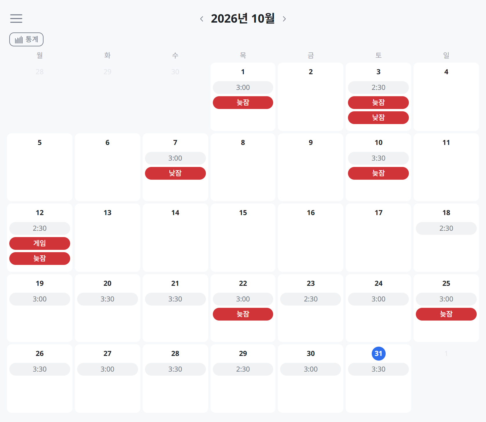

# Plan for myself

https://plan-for-myself.vercel.app



> 매일 실패한 것을 기록하고, 그 실패를 성공으로 바꿔 나가고 싶었습니다.

### 제공되는 기능

1. **달력** — 매일 공부시간과 실패한 것을 기록합니다
2. **통계** — 어떤 실패를 반복하고, 어떤 실패를 줄였는지 지난달과 비교해 보여 줍니다

이를 통해, 같은 실패를 반복하지 않도록 유도하고자 합니다.

## 대표 작업 사례

일정·기획, 디자인, 개발, QA, 배포를 혼자 진행했습니다.

무엇을 어떻게 만들지는 제가 정하고, 구현은 AI에 맡기고, 마지막 리뷰는 제가 했습니다.

### 디자인: 글자의 길이를 제한하기

#### 문제

> - 유튜…

달력의 휴대폰 화면에서 실패 태그 `유튜브`가 이렇게 잘렸습니다.

글자가 노출될 길이를 몇 px로 결정해야 할까요?

#### 근본적인 원인

**기준**이 있어야, 이 데이터는 화면에서 **100px**부터 말줄임 처리를 한다고 판단할 수 있는데, 그 기준이 없었습니다.

#### 해결

기준은 보여 줄 데이터의 특성에서 찾았습니다. 실패 태그는 늦잠·게임·유튜브·야식처럼 대부분 2~3글자 안에서 끝나서, 기준을 이렇게 결정했습니다.

1. **2~3글자**일 때 **가장 보기 좋도록** 디자인하되
2. (달력 기준) 4글자까지는 보이도록 했고,
3. 그에 맞게 입력 폼의 글자 수 제한도 6글자로 했습니다.

→ 실제 작업: [#100 실패 태그 길이를 상한 6글자·일반 길이 한글 4글자로 정하고 표시 칸을 맞춤](https://github.com/developer-choi/plan-for-myself/pull/100)

→ [전체 사례 보러가기](docs/cases/design.md#페이지-내-요소들을-우선순위에-맞게-강조하기)

### 개발: 만들어 둔 베스트 프랙티스 기반으로 짧게 지시하기

#### 문제

AI는 **풍부하게 설명해야** 의도대로 구현해 줍니다.

그 설명을 매번 반복하는 데 사람의 시간이 듭니다.

#### 해결

1. "이 기능은 이렇게 구현하는 것이 가장 좋다"는 [베스트 프랙티스](https://blog-sepia-pi-37.vercel.app/posts/infinite-scroll-step3)를 쌓아 두고,
2. 그것을 [목차로 정리](https://github.com/developer-choi/monorepo-playground/tree/master/docs/best-practices)해, AI가 폴더명과 파일명만 보고 필요한 것을 찾아가게 했습니다.

#### 결과

1. 구현하는 시간을 아껴, 베스트 프랙티스를 더 만들 수 있게 됐습니다.
2. 새로 만든 것도 같은 방식으로 정리해, 비슷한 것을 만들 때 다시 참고할 수 있게 됐습니다.

결과적으로, 구현은 종류별로 **한 번만** 하는 것을 목표로 하고 있습니다.

#### 단점

이런 식으로 문서를 계속 쌓아 나가면, 결국 AI가 읽어야 하는 컨텍스트 양이 많아지는 문제가 있습니다.

그래서 이것을 완화하기 위해, 문서를 **폴더 구조로 나눠** AI가 전부가 아니라 필요한 것만 읽게 했습니다.

```
coding-standards/
├── rules/
│   └── personal/
│       └── typescript/
│           └── basic.md
└── principles/
    └── personal/
        └── quality/
            └── co-location.md

best-practices/
├── testing.md
└── form.md
```

완화가 가능하다 해도 단점이 남아 있긴 합니다.

하지만, AI가 문서를 더 읽는 부담이 **매번 AI에게 설명**하는 시간이나 **설명을 빠뜨려** 다시 작업하는 시간보다는 작다고 판단했습니다.

→ [전체 사례 보러가기](docs/cases/development.md#정적-분석-도입)

## 기술 스택

- **코어** — Next.js (App Router), React, TypeScript, TanStack Query
- **폼** — react-hook-form, zod
- **UI** — [`@developer-choi/design-system`(개인 디자인 시스템)](https://github.com/developer-choi/monorepo-playground/tree/master/packages/design-system), Sass
- **테스트·품질** — Vitest, Testing Library, ESLint, Stylelint, Prettier, Commitlint
- **빌드·배포** — Turborepo, Yarn workspaces, Vercel
- **모니터링** — Sentry
