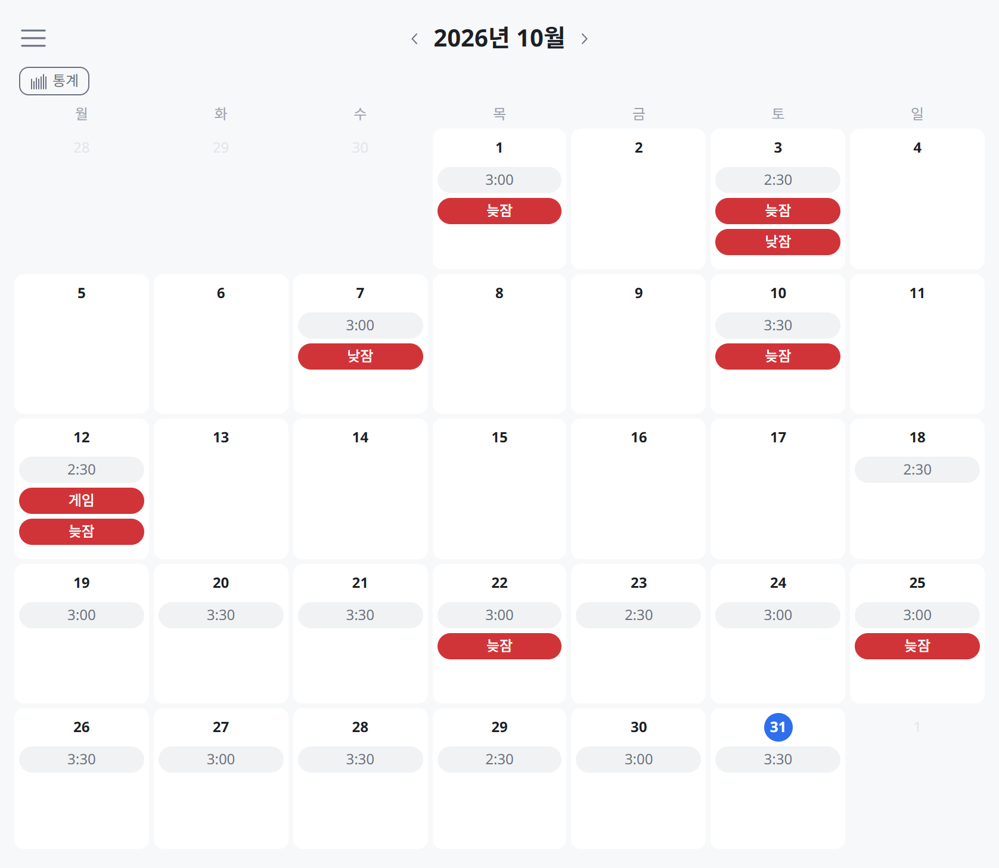
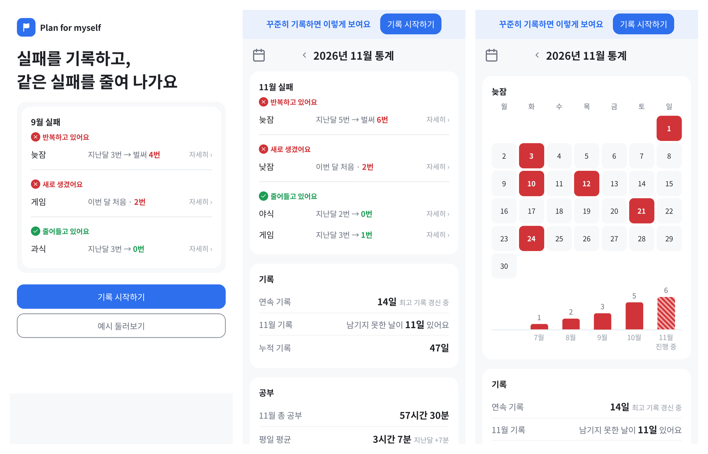

# Plan for myself

**Next.js 웹**: https://plan-for-myself.vercel.app



**Android 앱**: [APK 다운로드](https://github.com/developer-choi/plan-for-myself/releases/latest/download/plan-for-myself.apk) (Play 스토어 출시 준비 중, 2026-12-13 배포 예정)



<!-- 앱 시연 GIF(docs/assets/app-demo.gif)가 생기면 이 자리에 넣는다 -->

## 제공되는 기능

1. **달력**: 매일 공부시간과 실패한 것을 기록합니다
2. **통계**: 어떤 실패를 반복하고, 어떤 실패를 줄였는지 지난달과 비교해 보여 줍니다

이를 통해, 같은 실패를 반복하지 않도록 유도하고자 합니다.

일정·기획, 디자인, 개발, QA, 배포를 혼자 진행했습니다. 무엇을 어떻게 만들지는 제가 정하고, 구현은 AI에 맡기고, 마지막 리뷰는 제가 했습니다.

## 프로젝트 구조

```
packages/shared                 : 타입 · 입력 한도와 문구 · 날짜 계산 · 에러 code · API 함수 · 훅
├── apps/web     (Next.js)      : 웹 화면
├── apps/mobile  (React Native) : 앱 화면
└── apps/api     (NestJS)       : 기록 저장·통계 계산 API 서버
```

웹·앱·서버가 공통 패키지(packages/shared)를 가져다 사용합니다. 같은 코드를 한 번만 작성하므로 고칠 곳이 하나이고, 서버가 입력을 거절할 때도 웹·앱 폼과 **같은 입력 규칙과 같은 문구**로 거절합니다. ([모노레포로 옮기기](https://github.com/developer-choi/plan-for-myself/pull/35) · [공통 패키지 같이 쓰기](https://github.com/developer-choi/plan-for-myself/pull/36))

## 프론트

- [웹과 앱이 로직을 함께 사용하기](docs/cases/development.md#웹과-앱이-로직을-한-벌로-쓰기): 기록 폼 로직을 공통 패키지의 훅 하나로 두고, 웹과 앱은 화면만 각자 그리게 했습니다
- [정적 분석 도입](docs/cases/development.md#정적-분석-도입): AI가 자주 내는 실수를 커밋 시점에 막는 규칙을, 예외 주석이 늘어나는 노이즈와 리뷰에서 줄어드는 지적을 비교해 규칙마다 넣고 뺐습니다
- [AI 코드리뷰 도입](docs/cases/development.md#ai-코드리뷰-도입): 베스트 프랙티스 문서를 리뷰 기준으로 주고, AI 리뷰어마다 읽을 문서와 볼 관점을 달리 맡겼습니다
- [마지막은 항상 사람이 리뷰](docs/cases/development.md#마지막은-항상-사람이-리뷰): 코드를 머지하기 전에는 언제나 제가 직접 화면을 열어 결과물을 확인했습니다

## 백엔드

- [규칙을 코드가 아니라 DB가 지키게 하기](docs/backend/claims.md#규칙을-코드가-아니라-db가-지키게-하기): "한 사용자는 한 날짜에 기록 하나"를 DB 제약으로 걸어, 저장 요청이 겹쳐도 같은 날 기록이 두 개 생기지 않게 했습니다
- [서버가 거절한 이유를 code로 전하기](docs/backend/claims.md#서버가-거절한-이유를-code로-전하기): 모든 거절을 `{code, message}` 형식으로 통일해 응답하고, 입력 검증은 웹·앱 폼과 같은 공통 패키지 함수로 하게 했습니다
- [구성](docs/backend/claims.md#구성): 게스트와 Google 계정을 한 사용자 테이블에 두어, 게스트가 계정을 연결해도 기록을 옮기지 않게 했습니다

## 디자인

- [글자의 길이를 제한하기](docs/cases/design.md#글자의-길이를-제한하기): 예상한 실패 태그가 대부분 2글자에서 3글자라는 점을 근거로 달력의 표시 길이와 입력 글자 수 제한을 정했습니다
- [페이지 내 요소들을 우선순위에 맞게 강조하기](docs/cases/design.md#페이지-내-요소들을-우선순위에-맞게-강조하기): 사용자의 다음 행동을 바꾸지 않는 정보는 덜어내고, 봐야 할 숫자만 크기와 색으로 강조했습니다
- [문구 다듬기](docs/cases/design.md#문구-다듬기): 같은 기능에는 같은 단어를, 다른 기능에는 다른 단어를 붙여 버튼 이름만으로 차이를 알 수 있게 했습니다
- [AI에게 처음 오는 사람 역할 맡기기](docs/cases/design.md#ai에게-처음-오는-사람-역할-맡기기): 아무 정보도 주지 않은 AI에게 사이트를 둘러보고 설명하게 해, 설계 의도와 어긋난 곳을 고쳤습니다

## 기술 스택

- **코어**: Next.js (App Router), React, TypeScript, TanStack Query
- **서버**: NestJS, Drizzle ORM, PostgreSQL (Neon), Auth.js (next-auth), OpenAPI
- **폼**: react-hook-form, zod
- **UI**: [`@developer-choi/design-system`(개인 디자인 시스템)](https://github.com/developer-choi/monorepo-playground/tree/master/packages/design-system), Sass
- **테스트·품질**: Vitest, Testing Library, ESLint, Stylelint, Prettier, Commitlint
- **빌드·배포**: Turborepo, Yarn workspaces, Vercel (웹), Railway (API 서버)
- **모니터링**: Sentry
